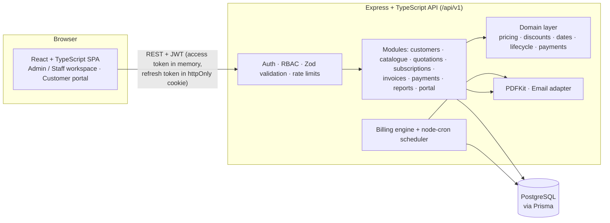
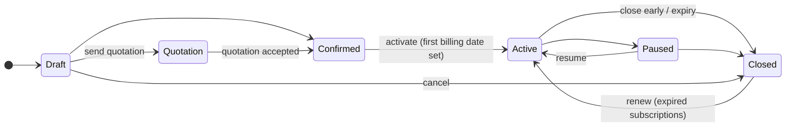
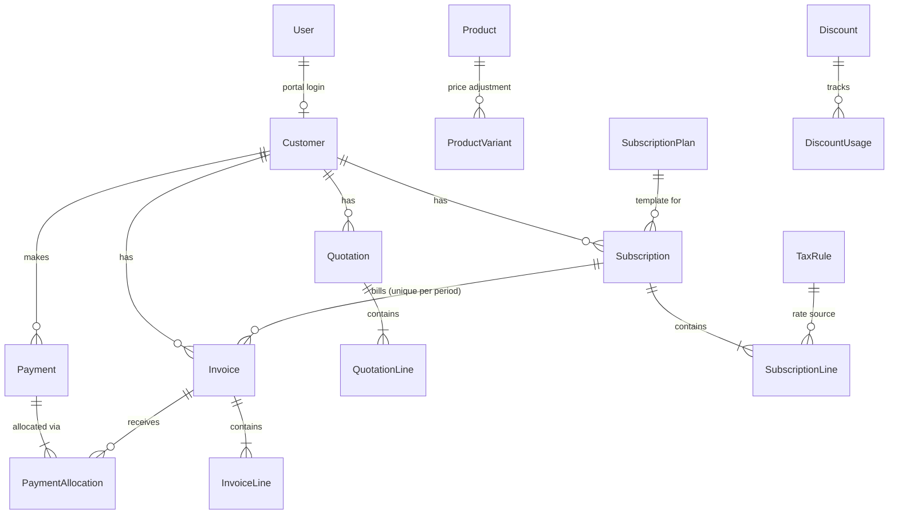

# Architecture & key workflows

## System context



## Layers

| Layer | Location | Responsibility |
|---|---|---|
| Domain | `server/src/domain` | Pure, unit-tested business rules: money (decimal.js), pricing, discount eligibility, billing dates, lifecycles, payment allocation, permissions. No database access. |
| Services | `server/src/services` | Transactional workflows: billing engine, quotation→subscription conversion, subscription lifecycle, pricing resolution, PDFs, email, reports. |
| Modules | `server/src/modules/*` | HTTP routes: validation, authorisation, response shaping. |
| Client | `client/src` | UI only. Totals shown in editors come from the server preview endpoint. |

## Recurring billing (the critical path)

```mermaid
sequenceDiagram
  participant Cron as node-cron / "Run billing now"
  participant Run as runBilling()
  participant DB as PostgreSQL
  Cron->>Run: trigger (SCHEDULED | MANUAL, asOf)
  Run->>DB: INSERT BillingJobRun; acquire run lock (Setting row)
  Run->>DB: expire quotations, auto-renew/close ended subscriptions
  loop batches of 100 (cursor by id)
    Run->>DB: SELECT ACTIVE subs WHERE nextBillingDate <= asOf
    loop each due period of each subscription
      Run->>DB: BEGIN
      Run->>DB: SELECT … FOR UPDATE (subscription row)
      Run->>DB: re-check still due
      alt invoice for billingPeriodKey exists
        Run->>DB: advance nextBillingDate only (SKIPPED event)
      else
        Run->>DB: evaluate discounts, UPDATE usedCount (conditional), INSERT Invoice + lines + DiscountUsage
        Run->>DB: advance nextBillingDate, INSERT events
      end
      Run->>DB: COMMIT (any error → ROLLBACK, date NOT advanced, FAILED event)
    end
  end
  Run->>DB: finish BillingJobRun (counts, errors); release lock
```

Guarantees: **no duplicates** (unique `Invoice.billingPeriodKey = subscriptionId:periodStart`, row lock, run lock); **nothing skipped** (all overdue periods billed in order); **safe retry** (failed period keeps its date, next run retries it); **bounded work** (batches, per-period transactions).

## Lifecycles



Invoice: `Draft → Confirmed → Partially paid → Paid`, `Cancelled` (only when unpaid). **Overdue** is derived (open + balance > 0 + due date passed), never stored. Quotation: `Draft → Sent → Accepted → Converted`, plus `Rejected`, `Expired`.

## Data model

See `server/prisma/schema.prisma`. Core relations:



Historical lines **snapshot** description, unit price, discount and tax rate, so editing or archiving a product never changes past quotations, subscriptions or invoices.
